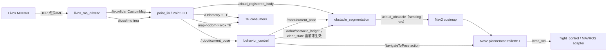
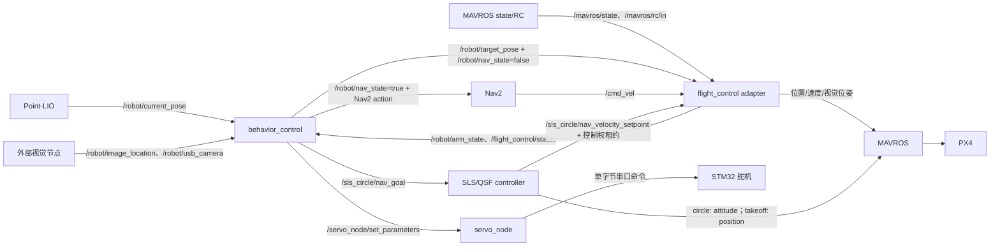

# ROS 包内与包间数据流审查

## 审查范围

本文根据当前源码、参数和 launch 静态追踪 ROS topic、service、action、TF 与离线文件流。审查日期：2026-10-27。没有连接飞控、雷达或运行时 ROS graph，因此“源码声明/配置为”不等价于“当前设备上已验证连通”。工作区含旧包、实验代码和仿真节点，以下将当前 launch 主链与兼容/实验支路分开说明。

## 1. 总览：包间数据流

### 1.1 感知、定位和导航



`sensing.launch.py` 默认启动 Livox、Point-LIO 和静态 TF；它默认**不**启动障碍物分割和 costmap。需要 costmap 时有两个不同组合：

- `sensing-costmap` 启动 obstacle_segmentation，但 `sensing_costmap.yaml` 的 costmap 当前直接订阅 `/cloud_registered_body`；障碍物节点的 `/cloud_obstacle` 在这个组合里没有被消费。
- `sensing-nav` 经 `lidar_nav_stack.launch.py` 使用 `drone.yaml` 的 costmap 参数，obstacle layer 订阅 `/cloud_obstacle`，此时障碍物分割输出才进入 Nav2。

### 1.2 任务、飞控、舵机和 SLS 控制



上图是不同模式的可选路径，不是一个必须同时运行的全量拓扑。Nav2、直接位置目标和 SLS 速度目标的输出模式需要互斥管理；圆周姿态控制则由 SLS 节点直接发布其 MAVROS setpoint。脚本 `run_echo_drone.sh` 为不同场景选择具体 launch 和话题配置。

## 2. 核心包内部数据流

| ROS 包/目录 | 包内处理 | 输入 | 输出/副作用 |
|---|---|---|---|
| `livox_ros_driver2` | 接收 MID360 网络数据并封装 ROS 消息 | 雷达 UDP 点云、IMU、命令数据 | `/livox/lidar`（MID360 常用 `CustomMsg`）、`/livox/imu`；frame 通常为 `livox` |
| `point_lio`（源码目录 `Point-LIO/`） | 同步点云和 IMU，预处理、状态估计与增量地图更新 | `lid_topic`、`imu_topic`，默认 `/livox/lidar`、`/livox/imu` | `/Odometry`、`/robot/current_pose`（`TransformStamped`）、`/cloud_registered`、`/cloud_registered_body`、`/Laser_map`、`/path`、`/cloud_obstacle_new`、`planner_normal`，并广播动态 odom 到 livox TF |
| `obstacle_segmentation`（源码目录 `obstacle_segmentation_tc/`） | 机体系点云转换到 map 系，根据当前高度/障碍物高度筛选点，再转回 livox 系 | `/cloud_registered_body`、`/robot/current_pose`、`/robot/obstacle_height`；`/robot/clear_state` 只被缓存 | `/cloud_obstacle`；`sensing-nav` 的 costmap 消费，`sensing-costmap` 直接消费原始 body 点云 |
| `behavior_control` | 两个定时循环推进旧 step 任务逻辑；另发布任务状态、事件和调试图 | `/robot/arm_state`、`/robot/current_pose`、`/robot/image_location`、`/robot/usb_camera`；Nav2 action 可用性 | 目标/模式/感知控制话题、Nav2 action goal、舵机参数请求、`/mission/*` 状态和调试服务 |
| `flight_control` | 缓存位姿/目标/速度，做坐标和高度转换、超时检查、输出源选择与 setpoint 重发；可请求 mode/arming 服务 | Point-LIO 位姿、MAVROS state/RC、任务目标、Nav2 `/cmd_vel`、SLS 速度目标和输出租约 | MAVROS 外部视觉输入、位置/速度 setpoint；回传 `/robot/arm_state`、`/flight_control/status` |
| `sls_circle_controller_cpp` | 定时读取状态和参考，运行 PD/QSF/风估计/任务阶段逻辑；对控制输出做门控 | MAVROS 状态、位姿/速度；可选负载位姿、实际风；可选任务目标 | 参考轨迹、调试姿态、状态/风估计；可直接发 position/attitude 到 MAVROS，或将 nav 速度 setpoint 交给 adapter |
| `sls_qsf_core` | 给 C++ SLS 节点提供 QSF 算法 C ABI 封装及生成算法实现 | SLS 控制器输入快照（函数调用，不是 ROS topic） | QSF 控制量（函数返回，不是独立 ROS 节点） |
| `robot_serial_manager` | 定时枚举串口并与设备清单匹配；不打开或转发业务串口 | OS 串口枚举、`ports.yaml` | `/hardware/serial_status` JSON、`/hardware/rescan_serials` 服务 |
| `servo_node` | 从 topic/service/兼容参数更新命令，校验范围并写入串口 | `/servo/command`、`/servo/drop`、`/servo/servo` 参数更新 | STM32 串口单字节 payload、`/servo/status` JSON |
| `robot_interfaces` | 只生成 ROS 接口类型，不主动处理运行时数据 | 不适用 | `ImageLocation`、`ServoPos`、`MissionStatus`、`MissionEvent` 及跳转服务类型 |
| `robot_bring_up` | 组合并按延时启动传感器、TF、costmap、Nav2、硬件等节点 | launch 参数、YAML 配置 | 本身主要是 launch 编排，不承担核心运行时数据转换 |
| `teb_local_planner` / Nav2 | Nav2 planner/controller/BT 消费地图和目标，TEB 作为 controller plugin 计算轨迹 | NavigateToPose action、costmap、TF/里程计 | `/cmd_vel`、action feedback/result、规划与调试数据 |

### 包内细节

- **Point-LIO**：订阅雷达消息和 IMU，估计状态并发布位姿和点云。当前 `drone.yaml` 将 Point-LIO `map_frame` 配成 `odom`、`odom_frame` 配成 `livox`，所以 `/Odometry` 和 `/robot/current_pose` 对应 odom 到 livox 的位姿；Nav2 主要通过 TF 获取机器人位姿，而不是把 `/Odometry` 当成直接控制命令。点云分支中 `/cloud_registered_body` 是当前障碍物分割节点的配置输入；Point-LIO 自己还发布 `/cloud_obstacle_new`，在当前 `drone.yaml` 的障碍物链路里没有被引用。
- **障碍物分割**：除点云外还依赖 `/robot/current_pose` 填充内部位姿缓存；`/robot/obstacle_height` 改变高度筛选上限。`/robot/clear_state` 当前只在回调中保存布尔值，没有参与清图逻辑；`base_frame`、`use_downsample` 参数也未实际使用。`/cloud_obstacle` 只被 `sensing-nav` 的 costmap 配置订阅，`sensing-costmap` 的 costmap 配置订阅 `/cloud_registered_body`。
- **behavior_control**：`step_timer_callback()` 决定 step 转移，`mission_timer_callback()` 发布任务动作。`/mission/graph_dot`、`/mission/status`、`/mission/event` 用于观测与调试；任务图目前不等于替代了旧 step 的正常转移执行。
- **flight_control**：`/robot/nav_state` 选择 Nav2 速度还是任务位置目标；`/robot/sls_goal_control_active` 让 SLS 速度输出租用 adapter 控制权，避免它同时发 Nav2/位置输出。超时后 adapter 清除控制权租约。
- **SLS/QSF**：圆周姿态控制路径向 MAVROS 发姿态和起飞位置 setpoint；`nav_goal_velocity` 路径将最终目标转成速度，由 adapter 转发。`publish_sls_goal_control_active` 和 `enable_real_setpoint` 会影响输出路径。
- **舵机**：behavior_control 当前通过 `/servo_node/set_parameters` 写兼容参数 `/servo/servo`，servo_node 同时也支持较新的 `/servo/command` 与 `/servo/drop`。因此主任务链不是直接发布 `/servo/command`。

## 3. 包间接口清单

### 定位、点云和导航

| 上游 | 接口 | 下游 | 用途 |
|---|---|---|---|
| `livox_ros_driver2` | `/livox/lidar` (`CustomMsg`) | `point_lio` | 原始 LiDAR 点云 |
| `livox_ros_driver2` | `/livox/imu` (`sensor_msgs/Imu`) | `point_lio` | IMU 数据 |
| `point_lio` | `/robot/current_pose` (`TransformStamped`) | behavior_control、obstacle_segmentation、flight_control | 当前 `odom -> livox` 位姿；adapter 另将其转为 MAVROS vision 输入 |
| `point_lio` | `/Odometry` (`nav_msgs/Odometry`) | 可视化/记录及定位诊断 | 里程计数据；Nav2 的机器人位姿主要通过 TF 获取 |
| `point_lio` | `/cloud_registered_body` (`PointCloud2`) | obstacle_segmentation | 当前帧机体系点云 |
| `behavior_control` | `/robot/obstacle_height`、`/robot/clear_state` | obstacle_segmentation | 高度筛选生效；clear_state 当前只被缓存 |
| `obstacle_segmentation` | `/cloud_obstacle` (`PointCloud2`) | `sensing-nav` 的 Nav2 local/global costmap | `sensing-costmap` 路径当前改为直接订阅 `/cloud_registered_body` |
| behavior_control / 操作者 | `navigate_to_pose` (`NavigateToPose` action) | Nav2 BT Navigator | 发送导航目标，取得 action 状态 |
| Nav2 controller | `/cmd_vel` (`Twist`) | flight_control adapter | 导航速度命令 |

### 任务和飞控

| 上游 | 接口 | 下游 | 用途 |
|---|---|---|---|
| flight_control adapter | `/robot/arm_state` (`Bool`) | behavior_control | 从 MAVROS 状态/RC 计算并回传的任务解锁状态 |
| behavior_control | `/robot/target_pose` (`TransformStamped`) | flight_control adapter | 直接位置目标链路 |
| behavior_control | `/robot/nav_state` (`Bool`) | flight_control adapter | 选择速度或位置控制源 |
| behavior_control | `/robot/passing_door_state`、`/robot/turning_state` | flight_control adapter | 穿门/转向控制转换上下文 |
| Point-LIO | `/robot/current_pose` | flight_control adapter | 外部视觉定位输入的源数据 |
| flight_control adapter | 配置中的 MAVROS vision topic | MAVROS `vision_pose` plugin | 向 PX4 输入外部视觉位姿 |
| flight_control adapter | 配置中的 position/velocity setpoint topic | MAVROS setpoint plugins | 位置、Nav2 速度或 SLS 目标速度输出 |
| MAVROS | `/mavros/state`、RC 输入 | flight_control adapter | 连接状态、模式、解锁、遥控器状态 |
| flight_control adapter | `/mavros/cmd/arming`、`/mavros/set_mode` 服务 | MAVROS | 按 adapter 参数请求解锁/模式切换 |
| behavior_control | `SetParameters` `/servo_node/set_parameters` | servo_node | 兼容旧投放命令 |

### 任务、视觉与执行器

| 上游 | 接口 | 下游 | 用途/状态 |
|---|---|---|---|
| 外部视觉节点（仓库外） | `/robot/image_location` (`ImageLocation`) | behavior_control | D435 识别结果；源码仓库未发现该 topic 的 ROS 发布者 |
| 外部视觉节点（仓库外） | `/robot/usb_camera` (`ImageLocation`) | behavior_control | USB 相机识别结果；源码仓库未发现该 topic 的 ROS 发布者 |
| behavior_control | `/camera/choose` (`Bool`) | 外部相机管理节点 | 切换相机；仓库内未发现订阅者 |
| behavior_control | `/servo_node/set_parameters` | servo_node | 投放位置/命令，旧参数兼容桥 |
| servo_node | 设备串口 | STM32 舵机 | 发送控制 payload；设备发现由业务节点自行完成 |
| robot_serial_manager | `/hardware/serial_status` | 操作者/监控工具 | 仅串口发现与状态，不把解析出的设备句柄交给 MAVROS/servo |

## 4. 三条主要控制链路要分开看

### A. Nav2 导航

```text
behavior_control --NavigateToPose action--> Nav2
Nav2 planner/controller --/cmd_vel--> flight_control adapter
adapter --MAVROS velocity setpoint--> PX4
```

此路径会经过 Nav2 costmap/TEB（前提是相应 Nav2 和 costmap launch 已启动）。`/robot/nav_state=true` 时 adapter 选择 Nav2 `/cmd_vel`；无新速度命令时 adapter 根据代码路径可输出零速度保持流。注意 `sensing-nav` 的 costmap 消费 `/cloud_obstacle`，而 `sensing-costmap` 当前直接消费 `/cloud_registered_body`。

### B. 任务直接位置目标

```text
behavior_control --/robot/target_pose--> flight_control adapter
adapter --MAVROS position setpoint--> PX4
```

此路径不经过 Nav2 局部避障。`/robot/nav_state=false` 时选择位置目标；目标超时后不会继续重发陈旧目标。

### C. SLS/QSF

1. **圆周 QSF/PD**：SLS 控制器订阅状态/位姿并直接发布姿态 setpoint（起飞阶段还可能发位置 setpoint）。adapter 通过 SLS 控制权租约抑制自身速度/位置输出。
2. **SLS 目标速度**：behavior_control 发布 `/sls_circle/nav_goal`；SLS 转换成 `/sls_circle/nav_velocity_setpoint`；adapter 收到 `/robot/sls_goal_control_active` 后选该源并写 MAVROS velocity setpoint。此模式由 SLS 跟踪目标，不等同于 Nav2 costmap 避障。
3. **纯位置圆轨迹**：SLS 的 `position` 模式发布位置 setpoint，并租用 adapter 控制权；不生成 QSF 姿态控制。

这三条链都可能最终影响 PX4。联调时应确认只启用了预期的控制器和输出源，不要仅根据节点都在运行就推断数据路由正确。

## 5. TF 数据流

感知链的 frame 关系由 `sensing.launch.py` 静态 TF 和 Point-LIO 动态 TF 组合：

```text
map --静态偏移--> odom --Point-LIO 动态位姿--> livox
livox --静态外参--> mavlink_body
livox --静态外参--> camera_link
```

当前 `drone.yaml` 的 Point-LIO 参数配置 `map_frame: odom`、`odom_frame: livox`；因此里程计消息和广播变换实际是 `odom -> livox`，上游 `map -> odom` 由 launch 静态发布。behavior_control 收到 `/robot/current_pose` 后把值用于 map 目标并补 z=0.39；障碍物分割则在位姿回调补 z=0.27；flight_control 另按其配置做外部视觉/目标高度转换。偏置和 frame 语义分布在 launch、参数和业务代码中，修改时必须整体核对。

## 6. 旁路包、离线工具和不参与主链的代码

| 包/目录 | 数据形式 | 与主链关系 |
|---|---|---|
| `robot_mapping/merge_pcd` | 读取一组 PCD 文件并写合并 PCD | 离线文件处理，无实时 ROS topic 链 |
| `robot_mapping/pcd2pgm` | 读取 PCD，生成 PGM/YAML 地图 | 离线文件转换，再由 Nav2 map server 等加载 |
| `detect/run_camera_yolo.py` | OpenCV 读本地摄像头、Ultralytics 推理并显示图像 | 当前是独立 Python 程序，不发布 `ImageLocation` ROS 消息，不能单独满足 behavior_control 视觉输入 |
| `robot_behavior_tree/*` | 历史自定义 BT/action 包 | 三个子包含 `COLCON_IGNORE`，当前主导航 launch 使用官方 Nav2 BT navigator/recoveries |
| `mavlink_control` | 旧 pymavlink 直连 | hardware launch 中显式 fallback，默认关闭；与 MAVROS adapter 有重叠的飞控职责，不应并行启动 |
| `sls_circle_controller` Python nodes | fake MAVROS、Gazebo bridge、GUI 和旧算法代码 | 仿真/实验配套；当前主 SLS 节点是 `sls_circle_controller_cpp` |
| `flight_control/mavros_ambiguous_topic_splitter.py` | 将 MAVROS 同名但类型不同的 topic 转为 rosbag 专用名称 | 录包辅助工具，不是默认控制路径 |

## 7. 审查发现与待核实项

1. **视觉链路尚未闭合在本仓库内。** `behavior_control` 明确订阅两个识别 topic，仓库中的 `detect/run_camera_yolo.py` 只显示 YOLO 检测结果，并不发布 ROS 消息。若任务依赖视觉识别，需要独立视觉 ROS 节点或桥接器提供这些 topic。
2. **MAVROS topic 命名依赖 Foxy/MAVROS 版本和插件配置。** `flight_control/config/mavros_adapter.yaml` 对 vision 和 setpoint 使用了 `/mavros/mavros/...` 端点；MAVROS 运行记录也见到 `/mavros/mavros/*`。但 SLS YAML 的通用默认 pose/velocity/setpoint 名是 `/mavros/local_position/...`、`/mavros/setpoint_...`，而 `run_echo_drone.sh` 实机别名和 PX4 SITL launch 会覆盖为嵌套名字。请以目标机器 `ros2 topic info -v` 的实际 publisher/subscriber 类型为准；尤其确认 SLS 位姿反馈订阅的是飞控输出，而非 vision 输入口或无人发布端点。
3. **Point-LIO 存在额外 `/cloud_obstacle_new` 输出。** 当前障碍物节点从 `/cloud_registered_body` 处理并生成 `/cloud_obstacle`；`sensing-nav` 路径的 Nav2 使用后者，`sensing-costmap` 路径则直接使用原始 body 点云。不要把这三个点云流混为一谈。
4. **视觉/相机切换接口有外部依赖。** `/camera/choose` 只有 behavior_control 发布者；仓库未包含对应相机管理订阅者。
5. **串口状态不是设备分配服务。** robot_serial_manager 只枚举并报告设备，MAVROS 和 servo_node 仍按各自配置发现/打开端口；报告的 `owner` 是约定，不是内核锁或资源句柄。
6. **Nav2 与 `sls_goal` 的避障能力不同。** Nav2 路径经 costmap；behavior_control 的 `navigation_execution_mode=sls_goal` 只把最终目标交给 SLS 控制器，不会自动调用 Nav2 obstacle costmap。
7. **历史包中存在额外同名输出端。** `mavlink_control` 与 MAVROS adapter 都可提供 `/robot/arm_state`，如果同时运行会造成多发布者语义冲突；硬件 launch 默认关闭 legacy fallback。
8. **frame 与高度换算不是单一来源。** Point-LIO 当前发布 `odom -> livox`，sensing launch 另发 `map -> odom`；behavior_control 和障碍物分割分别对 pose z 加不同偏移，adapter 还有 vision/FCU 高度参数。`TransformStamped` 的 header frame、话题名和消费端实际假设要一起核实。
9. **障碍物清图接口未落地。** `/robot/clear_state` 已有订阅回调，但当前没有读取该状态执行清除；文档和任务逻辑不能把它当成有效清图命令。
10. **costmap 观测源不一致。** 同一个 `obstacle_segmentation` 节点在不同 launch 组合下可能未被消费；排查 Nav2 避障时必须先确认 costmap 的 observation source 是 `/cloud_obstacle` 还是 `/cloud_registered_body`。
11. **SLS 实机 topic 与单节点默认可不同。** `run_echo_drone.sh` 的 `real-*` 模式会覆盖 SLS 的 pose 和 takeoff position 端点；`sls-real-check` 仍采样旧通用端点，观察不到全部真实输出。

## 8. 运行时核对清单

在实际组合启动后，从已 source 工作区的终端执行：

```bash
ros2 topic list -t
ros2 node list
ros2 topic info -v /robot/current_pose
ros2 topic info -v /mavros/state
ros2 topic info -v /mavros/mavros/pose
ros2 topic info -v /mavros/mavros/local
ros2 topic info -v /mavros/mavros/cmd_vel
ros2 topic info -v /cloud_registered_body
ros2 topic info -v /cloud_obstacle
ros2 topic info -v /cmd_vel
ros2 action list -t
ros2 service list -t
```

应将每条关键 topic 的发布者、订阅者和消息类型与本页表格对照；发现零发布者、多个控制 setpoint 发布者、消息类型不一致或 frame 不一致时，先定位 launch 参数/重映射/插件配置，再进行实机控制验证。

## 9. 源码索引

- Point-LIO 接口创建和里程计发布：`Point-LIO/src/laserMapping.cpp`
- 感知链路 launch 与 TF：`robot_bring_up/launch/sensing.launch.py`
- 点云过滤和输出：`obstacle_segmentation_tc/src/obstacle_segmentation.cpp`
- 任务接口与定时器：`behavior_control/src/behavior_control.cpp`
- MAVROS 适配和输出选择：`flight_control/flight_control/mavros_adapter_node.py`
- MAVROS 插件/topic 配置：`flight_control/config/mavros_vision_px4.yaml`、`flight_control/config/mavros_adapter.yaml`
- SLS ROS 接口与控制循环：`sls_circle_controller_cpp/src/sls_circle_controller_node.cpp`
- 硬件层组合：`robot_bring_up/launch/hardware.launch.py`
- 导航 costmap/action 组合：`robot_bring_up/launch/lidar_nav_stack.launch.py`、`robot_bring_up/launch/sensing_nav.launch.py`
